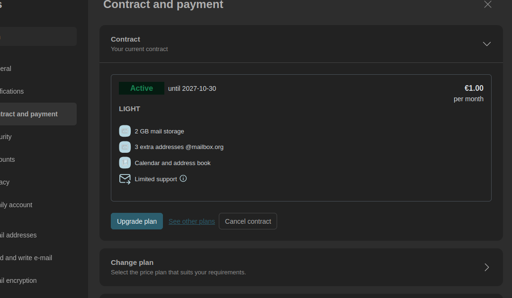

# Child Protection Researcher Banned from Sending: Paid Through 2027, Rejected as an Unpaid Trial

Dustin Sprenger | Public evidence record | 26 October 2026

My mailbox.org subscription screen said “Active until 2027-10-30.” Its mail service rejected an external message as an unpaid trial. Support subsequently said my account had been disabled for mass-sending “fraudulent/phishing/spam” emails. The public complaint was marked “Solved,” its OSF research links were removed, and replies were locked.

Calling a complaint solved does not explain contradictory account messages. Calling correspondence spam does not identify the messages, explain the unpaid-trial wording, or answer a request for review. I am publishing the underlying records so the explanation can be tested against evidence.

“Banned from sending” describes the documented sending restriction and support's statement that the account was disabled. This record does not establish permanent termination, a forum-account ban, or restriction because of my research. The subscription screenshot supports the active-plan claim in the title; payment-system and account-mapping records remain with mailbox.org.

[Locked original forum report](https://userforum-en.mailbox.org/topic/5771-active-light-plan-until-2027-10-30-but-sending-blocked-as-an-unpaid-trial-554-5-7-1) · [Public support comment](https://userforum-en.mailbox.org/topic/5771-active-light-plan-until-2027-10-30-but-sending-blocked-as-an-unpaid-trial-554-5-7-1#comment-15416)

## The contradiction

| Record | What it says | What remains unanswered |
|---|---|---|
| Subscription screenshot | LIGHT, EUR 1.00/month, “Active until 2027-10-30” | The image has no account address. I identify it as the affected account; support must verify the account/alias mapping. |
| Webmail rejection | “unpaid test accounts may not send e-mails to external mail addresses” | Why did this specific explanation appear for the account shown as active? |
| Private support reply | Account disabled for mass-sending fraudulent/phishing/spam emails | Which messages, which classification, which evidence, and when was the restriction applied? |
| Public forum | “Solved”; links removed; replies locked | Where is the technical resolution or appeal outcome? |



The original image is unchanged. SHA-256: `86b1c8cb63595cc0b3e24f5d9496b8aeb569aea401b1df69141a25dc803befce`.

## Exact rejection

The recipient address alone is redacted. The asterisk separator lines below are part of the original error, not emphasis added to this report.

```text
Message could not be sent to the following recipients: "[external recipient redacted]" <[external recipient redacted]> (554 - 554-5.7.1 <[external recipient redacted]>: Relay access denied
554-5.7.1 ******************
554-5.7.1 Please note: To avoid misuse, unpaid test accounts may not send e-mails to external mail addresses.
554-5.7.1 ******************
554-5.7.1 Um Missbrauch zu vermeiden duerfen unbezahlte Test-Accounts keine E-Mails an externe Mailadressen versenden.
554 5.7.1 ******************
)
```

[Preserved rejection transcription and original-text hash](rejection-exact-redacted.txt). The original full error screenshot remains in the private evidence archive because it contains personal information.

An active subscription does not exempt anyone from an anti-spam policy. The unresolved question is why the service gave an unpaid-trial explanation if a different enforcement restriction was in effect. I am asking for the actual reason and review, not exemption from rules.

## What support actually said

The private reply, dated 26 October 2026 at 09:34:16 UTC, states:

> Your account has been used for mass-sending of fraudulent/phishing/spam e-mails. This violates our terms of use (see section 8 at [1] https://mailbox.org/en/t-cs-cancellation-policy). Your account has been disabled.

It was signed “Jens, mailbox Support.” The preserved reply does not identify an offending message, provide a Message-ID, distinguish spam from fraud or phishing, or explain the trial-account error. Its legacy ticket subject “Hacked account” is not evidence that hacking occurred.

[Private decision: readable public copy](support-account-disabled.txt) · [Redacted EML derivative](support-account-disabled.eml)

The public comment, preserved in a notification dated 26 October 2026 at 10:39:14 UTC, says:

> As this matter has already been addressed through our support channel, we won’t discuss the details of this individual case publicly.
>
> Sending spam via mailbox.org violates our Terms of Service, and we take appropriate action to enforce them.
>
> We’re closing this thread as further discussion here would not be productive.

[Forum notification](forum-spam-notification.txt) · [Redacted EML](forum-spam-notification.eml). The live page also states: “Replies have been locked on this page!”

## The OSF links were removed

This is a documented moderation action, not an inference from a broken link. The live report contains the note:

> Note from mailbox moderator: Links removed for data security reasons

The preserved earlier published text contains five OSF URLs. In the later capture, the research labels remain but those URLs are absent. The stated reason is recorded here without claiming an unstated motive. The preserved material does not identify a specific unsafe OSF URL or explain what security problem it presented.

[Earlier published text with all five links](forum-before-published-text.txt) · [Later visible page text and capture time](forum-after-visible-text.txt) · [Full later screenshot](forum-after-locked.jpg)

The earlier file is a locally preserved publication record; the later page capture independently shows the moderator's admission of link removal. Hashes establish the bytes preserved here, not when an independent third party first saw them.

## The government emails are included

Ten original outbound EML files from 22 October 2026 were located. Their recipient lists contain 194 address entries across government, embassy and research contacts; this is not a count of unique people or confirmed deliveries. The messages were sent in batches and are bulk outreach. Research purpose alone does not determine whether sending complied with the provider's rules.

Each message contains three research attachments: `EMELIA_Final_SymV.odt`, `FLORA_v2_Privacy_Strengthened.odt`, and `ABEL_v19.1.md`. The public copies preserve the message bodies, subject, date, original Message-ID, recipient domains, attachment names and hashes. Original attachments and private addresses are omitted from these derivatives; the research is linked below. The original EML files and attachments remain unchanged locally.

[Outreach index](EMAIL-INDEX.md) · [Source hashes, dates, recipient-domain lists and attachment hashes](evidence-ledger.json)

A sent copy does not prove that any recipient server accepted the message or that a person read it. None of these ten messages has been specifically identified as offending in the support reply preserved here. Statements in the original outreach are the author's statements, not findings independently established by this account-restriction report.

The account correspondence is also included: [initial support acknowledgment](support-acknowledgment.txt), [blocked-account follow-up](user-blocked-followup.txt), and [formal complaint and log-preservation request](user-formal-complaint.txt). A separate 23 October attempt to contact US state financial-regulatory offices also received relay denial; it must not be confused with delivery of the ten earlier messages.

## Research context, restored here

I am an independent researcher whose work includes proposed child-protection infrastructure and synthetic cognitive architectures. These public records explain the subject of the correspondence; they do not establish why mailbox.org restricted the account.

- Public research profile: https://osf.io/7bhyw/
- EMELIA: https://osf.io/7jpzr/
- FLORA: https://osf.io/jwd4u/
- ABEL: https://osf.io/a2qy7/
- C.H.I.L.D.: https://osf.io/9m253/

## What I ask mailbox.org to answer

1. Identify the messages relied upon, with dates and Message-IDs, and explain whether the finding was bulk unsolicited mail, fraud, phishing, or another category. Personal recipient data can remain private.
2. Explain the active-plan/unpaid-trial mismatch, including the relevant account/alias mapping, trial flag and restriction timeline.
3. Name a responsible support or engineering owner and provide an appeal route. Restore sending if review finds the restriction mistaken; otherwise give the specific basis, scope, duration and available remedy.
4. Explain the precise security reason for removing the OSF URLs and reopen the original thread for a factual resolution or publish a substantive response.
5. Preserve the relevant account-state changes, mail rejection events, enforcement decisions, support correspondence and forum moderation history while the dispute is reviewed.

This record will remain available independently of the forum. A documented explanation or correction will be added with its date. The evidence justifies demanding an answer; it does not justify inventing the cause.

## Additional policy context and unanswered questions

[Apple terms and the Runbox–Mistral–CERN connection](CONTEXT-APPLE-RUNBOX.md) documents Apple’s revised storage/access clauses, a change in Runbox Boxy logging, and Mistral’s separate CERN partnership. It identifies the source dates and limits of each claim. The evidence supports an indirect supplier connection, not a direct Runbox–CERN integration or proof that these matters caused this sending restriction.

## Preservation and privacy

[Preservation and redaction method](PRESERVATION.txt) · [SHA-256 manifest](SHA256SUMS.txt)

Public EMLs are expressly labeled reconstructed, redacted derivatives. They are not originals and cannot be used to validate the original DKIM signatures. No passwords, session tokens, payment-card details, home address or personal recipient addresses are intended for publication. The original evidence has not been modified.
